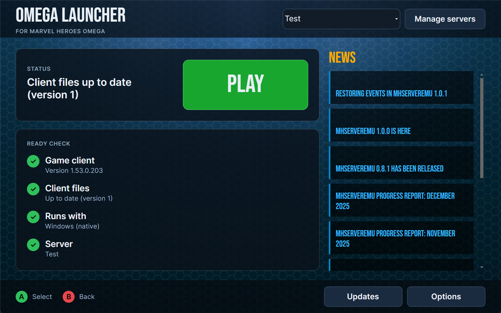

# Omega Launcher

Omega Launcher is the player launcher and client updater for a Marvel Heroes Omega private server.

It is based on [Bifrost](https://github.com/Crypto137/Bifrost) by Crypto137 (MIT license). The launcher window, the update system and the Linux / Steam Deck support are new; the
client launching, server list and news feed come from Bifrost. See `LICENSE` for the original license.

## Features

* Checks your game files against what the server publishes, and downloads only what changed (chunked, signed and verified).
* Backs up the original game files first, and can restore them.
* Launches the game with the server selected in the launcher; on Linux and Steam Deck it runs the game through Proton, umu or Wine.
* One layout (1280x800) on PC and Steam Deck, with keyboard and D-pad focus.
* Server list, customizable news feed, and the hidden client options (custom resolution, auto-login) from Bifrost.

## Installation

1. Get the stock 1.53.0.203 Marvel Heroes client (for example from Steam).

2. Download the Omega Launcher release from your server's page and extract it anywhere. The launcher finds the game in your Steam libraries, or asks for the folder.

3. Run `OmegaLauncher.exe` (Windows) or `OmegaLauncher` (Linux), press **Update** when asked, then **Play**.

**NOTE: Omega Launcher is an unsigned executable that starts another process. This may cause false positive detections from various antivirus and antimalware software. If this causes inconvenience, please feel free to build the source code yourself.**

## For the server owner

* `docs/PUBLISHING.md` explains how to publish a client update.
* `docs/PRIVACY.md` explains what never goes into this repository (server address, logins, keys).

## Building

Requires the .NET 8 SDK: `dotnet build OmegaLauncher.sln`. The Windows (WPF) project is the original Bifrost front end and is not maintained here.
